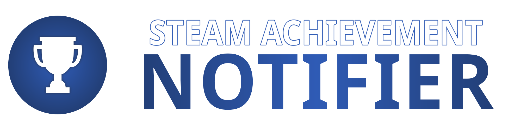
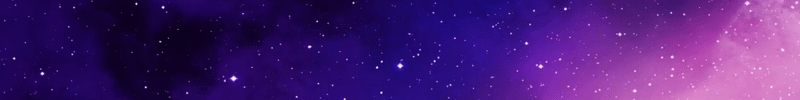
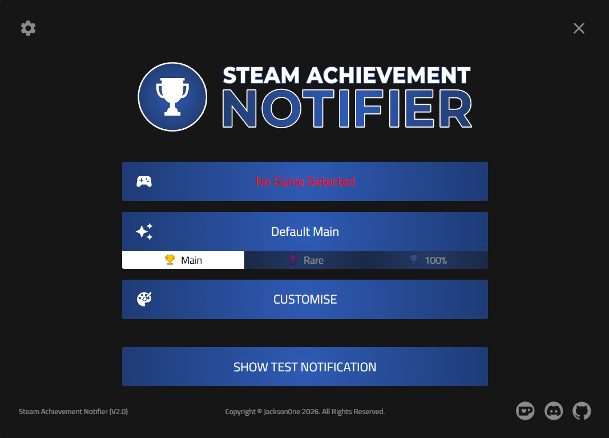

<!--  -->

**Steam Achievement Notifier** shows fully customisable notifications when you unlock any achievement on Steam.

Each notification type - **Main** (*for regular achievements*), **Rare** (*for achievements with a rarity below 10%*) and **100%** (*for unlocking all achievements in any game*) - can be personalised to your liking using a wealth of customisation options available via the **Steam Achievement Customiser** menu. Just click the **Customise** button to get started!

> [!CAUTION]
> #### Fullscreen display modes are not supported\*
> Games using **DirectX 9/10/11** require **Borderless**/**Borderless Windowed** mode to be enabled via in-game display settings in order for notifications to show above the game window.
> 
> \**If a game supports and runs using **DirectX 12**, notifications will usually show above the game window if the in-game display setting is set to **Fullscreen** (but not **Exclusive Fullscreen**).*

 

| <a href="#features">Features</a> | <a href="#installation">Installation</a> | <a href="#credits">Credits</a> |
| --- | --- | --- |

 

<h2 align="center" id="features">Features</h2>

<h4>🏆 Real-Time Achievement Tracking</h4>

Just run the app and start unlocking achievements - no configuration required!

<h4>🖌 Redesigned UI</h4>

The app UI has been redesigned to enhance user experience, with updated elements, menus, and options.

Once you're done customising, minimise the app window to the system tray to keep tracking achievements in the background.

<h4>🎨 Fully Customisable Notifications</h4>

Each notification type provides a wealth of customisation options to personalise your Steam achievements.

First, choose a **Notification Preset**, each with bespoke designs and animations.

Then, start designing - change the background, shape, colours, size, display time, icons, position, font, opacity - and much more!

<h4>🎶 Custom Sounds</h4>

Load custom sounds that play whenever you unlock an achievement! In the **Customiser**, choose the **Sound Mode** for each notification type:

- **File**: Load a single audio file
- **Randomised**: Select a folder containing multiple audio files, which are then played at random

Adjust the in-app volume, preview the sound and then unlock achievements to hear it.

<h4>✨ Themes</h4>

All customisations made via the **Customiser** menu can be saved as a custom **Theme**, and reloaded at any time by selecting it via the new **Theme Select** menu on the Home screen.

Name your masterpiece, give it an icon (*or load your own using the **+** icon in the **Save Theme** dialog*), and switch between saved **Themes** whenever you like.

Additionally, all created **Themes** can be imported/exported, making them easy to share with other users.

<h4>💯 100%/Set Completion Notifications</h4>

The **100%** notification type will show a customisable notification when all achievements have been unlocked in any game.

**Set** notifications will show a separate, customisable notification when all achievements in a Steam achievement set have been completed.

**Set** notifications can also be toggled on/off via **Settings** > **Notifications** > **100% Set Notifications**.

> [!WARNING]
> **Set** notifications will only show for compatible Steam games that incorporate achievement sets

<h4>📷 Media</h4>

**Settings** > **Media** > **Additional Media** includes the following options to automatically take a screenshot when any achievement is unlocked:

- **Screenshot Only**: Takes a screenshot of the selected monitor.
- **Screenshot with Notification Overlay**: Takes a screenshot of the selected monitor, then overlays an image of the achievement notification - including all customisations!
- **Notification Image**: Generates an PNG image of the notification itself, which can then be directly shared, or added as an overlay elsewhere.

Various additional options - such as **Screenshot Mode**, **HDR Mode**, **Screenshot Format**, **Screenshot Path**, **Screenshot Delay** and more - are available to further configure and customise your screenshots!

<!-- > [!WARNING]
> 🐧 In order to enable **Take Steam Screenshot** on Linux, `xdotool` must be installed on the system -->

> [!WARNING]
> 🐧 In order to enable **HDR Mode** on Linux, `libxcb1`, `libxrandr2` and `libdbus-1-3` must be installed on the system

<h4>🎥 Stream Notifications</h4>

**Stream Notifications** creates a background window which duplicates all on-screen notifications, which is targetable as a window source within streaming software - such as OBS/Streamlabs/Twitch Studio etc.

By setting this window as your source, you can overlay achievement notifications directly into your streams!

<h4>📊 Achievement Stats Overlay</h4>

Display a configurable list of achievements for Steam/**RetroAchievements** games in a separate window targetable by streaming software.

Toggle between displaying everything or just the progress bar, then configure the order of the list, the number of displayed achievements, displaying locked/unlocked achievements, the opacity of the window and more!

Additionally, any unlocked achievements will be moved to the top of the list, play an unlock animation and update the progress bar in real-time.

<h4>⌛ Game Completion Timer</h4>

Show a precise timer in a separate window targetable by streaming software, which displays the amount of time taken to unlock all achievements in the current Steam/**RetroAchievements** game.

Once all achievements have been unlocked, the timer will stop to display the total time taken to achieve 100% completion.

The timer will remain stopped at the time of completion for any subsequent launches of completed games, but can be manually reset per-game via the **Reset Timer** button while the completed game is detected.

<h4>🌍 Localisation</h4>

All UI and notification elements have been translated into most Steam-supported languages. Just select your preferred language from the **Settings** menu.

<h4>📡 Auto Updater</h4>

Using [electron-builder's autoUpdater](https://www.electron.build/auto-update.html), users will now be notified if a new update is available - if so, the download/installation of new updates will be handled automatically.

<h4>🕹 RetroAchievements Support</h4>

Display customised notifications for **RetroAchievements** earned in supported emulators\*! Most existing functionality available for Steam achievements - such as **Screenshots**/**Notification Images**/**Game Art** etc. - is also available for **RetroAchievements** notifications!

> [!NOTE]
> \*For information on currently supported/incompatible emulators, prerequisites and setup, see the [RetroAchievements](https://github.com/SteamAchievementNotifier/SteamAchievementNotifier/blob/master/RA.md) section

<h2 align="center" id="installation">Installation</h2>

1. Go to the [Releases](https://github.com/SteamAchievementNotifier/SteamAchievementNotifier/releases) page
2. Expand the **Assets** section at the bottom of the latest release, then download:

| Platform | Installer |
| -- | -- |
| **Windows**  | `Steam Achievement Notifier (V2.0.X).exe` |
| **Linux** | `Steam Achievement Notifier (V2.0.X).AppImage` |

2. Once downloaded, run the installer
3. Customise your notifications and start unlocking achievements!

<h2 align="center" id="credits">Credits</h2>

**Steam Achievement Notifier** uses (*and thanks!*) the following projects:

- [node-vdf]() by [xan105](https://github.com/xan105)
- [electron-store](https://github.com/sindresorhus/electron-store) by [sindresorhus](https://github.com/sindresorhus)
- [HackTimer](https://github.com/turuslan/HackTimer) by [turuslan](https://github.com/turuslan)
- [vdf-parser](https://github.com/rossengeorgiev/vdf-parser) by [rossengeorgiev](https://github.com/rossengeorgiev)
- [fs-extra](https://github.com/jprichardson/node-fs-extra) by [jprichardson](https://github.com/jprichardson/)
- [electron-builder/electron-updater](https://github.com/electron-userland/electron-builder)
- [Tippy.js](https://atomiks.github.io/tippyjs/)
- [vdf-rs](https://github.com/CosmicHorrorDev/vdf-rs) by [CosmicHorrorDev](https://github.com/CosmicHorrorDev)
- Custom forks of [screenshots (xcap)](https://github.com/nashaofu/xcap)/[display-info](https://github.com/nashaofu/display-info) by [nashaofu](https://github.com/nashaofu)
- [icojs](https://github.com/egy186/icojs) by [egy186](https://github.com/egy186)
- [iro.js](https://github.com/jaames/iro.js) by [jaames](https://github.com/jaames)
- [sortable](https://github.com/SortableJS/Sortable) by [SortableJS](https://github.com/SortableJS)
- [new-vdf-parser](https://crates.io/crates/new-vdf-parser) by [Tormak9970](https://github.com/Tormak9970)