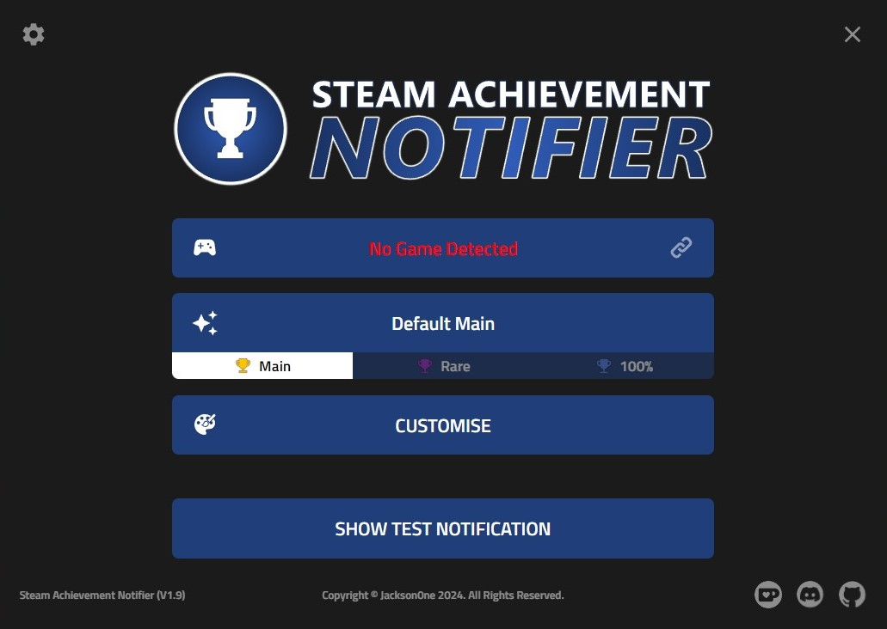

<!--  -->

**Steam Achievement Notifier** shows fully customisable notifications when you unlock any achievement on Steam!

Each notification type - **Main** (*for regular achievements*), **Rare** (*for achievements with a rarity below 10%*) and **100%** (*for unlocking all achievements in any game*) - can be personalised to your liking using a wealth of customisation options available via the **Steam Achievement Customiser** menu. Just click the **Customise** button to get started!

> [!CAUTION]
> #### Fullscreen display modes are not supported\*
> Games using **DirectX 9/10/11** require **Borderless**/**Borderless Windowed** mode to be enabled via in-game display settings in order for notifications to show above the game window.
> 
> \**If a game supports and runs using **DirectX 12**, notifications will usually show above the game window if the in-game display setting is set to **Fullscreen** (but not **Exclusive Fullscreen**).*

 

| <a href="#features">Features</a> | <a href="#updates">Updates</a> | <a href="#installation">Installation</a> | <a href="#credits">Credits</a> |
| --- | --- | --- | --- |

 

<h2 align="center" id="features">Features</h2>

<!--
<h2 align="center" id="features">Features</h2>

- 🏆 **Realtime Achievement Tracking**: By implementing Steamworks (*provided by custom fork of [steamworks.js](https://github.com/ceifa/steamworks.js/)*), **Steam Achievement Notifier** no longer requires an *API Key*/*Steam64 ID* - just run the app and start unlocking achievements, with no configuration required! This also allows greater functionality to be added in future updates, so stay tuned!

- 🖌 **Redesigned UI**: The in-app UI has undergone a complete redesign to enhance user experience, with updated elements, menus, and options for a simplified and modernised look! Once you're done customising, minimise the app window to the system tray to keep it running it in the background. In **V1.9**, the app window is also now resizable!

- 🎨 **Fully Customisable Notifications**: Each notification type provides a wealth of customisation options to truly personalise your Steam achievements! First, choose a **Notification Preset** (*each with bespoke designs and animations*). Then, start designing - change the background, shape, colours, size, display time, icons, position, font, opacity - and much more!

- 🎶 **Custom Notification Sounds**: Load custom sounds that play whenever you unlock an achievement! In the **Customiser**, choose the **Sound Mode** for each notification type: **File** (*load a single audio file*) or **Randomised** (*select a folder containing multiple audio files which are then played at random*). Adjust the in-app volume, preview the sound and then unlock achievements to hear it! (*All in-app sounds can also be muted via the new <a href="#audiosrc">**Audio Source**</a> Settings option!*)

- ✨ **Themes**: Brand new to **V1.9**, all customisations made via the **Customiser** menu can be saved as a custom **Theme**, and reloaded at any time by selecting it via the new **Theme Select** menu on the Home screen. Name your masterpiece, give it an icon (*or load your own using the **+** icon in the **Save Theme** dialog*), and switch between saved **Themes** whenever you like!

- 💯 **100% Notification Type**: The newest notification type - **100%** - will show a notification when all achievements have been unlocked in any game! Additionally, this notification type is also now fully customisable with all customisation options available for **Main** and **Rare** types (*plus more options exclusive to this type*)!

- 📷 **Additional Media Options**: Includes options to automatically take a Steam screenshot when any achievement is unlocked, as well as generating a **Screenshot with Notification Overlay** (*by selecting the dropdown option under **Settings** > **Additional Media***), which takes a screenshot of your chosen monitor, and overlays an image of the achievement notification - including all customisations! Also new to V1.9, the **Notification Image** option generates an image of the notification itself, which can then be directly shared or added as an overlay elsewhere!

> [!WARNING]
> 🐧 In order to enable **Take Steam Screenshot** on Linux, `xdotool` must be installed on the system

> [!WARNING]
> 🐧 In order to enable **HDR Mode** on Linux, `libxcb1`, `libxrandr2` and `libdbus-1-3` must be installed on the system

- 🎥 **Stream Notifications**: Building on the foundations of the **Duplicate Notification to Window** option available in previous versions, **Stream Notifications** creates a background window that duplicates all on-screen notifications - including all customisations - which is targetable as a window source within streaming software, such as OBS/Streamlabs/Twitch Studio etc. By setting this window as your source, you can overlay all achievement notifications directly in your streams!

- 📊 **Achievement Stats Overlay**: Display a configurable list of locked achievements and a completion progress bar for the current game in a window targetable by streaming software.  Configure the order of the list, limit the number of displayed achievements, the opacity of the window and more! Additionally, any unlocked achievements will be moved to the top of the list (regardless of the display limit set), play an unlock animation and update the progress bar in real-time!

- 💬 **Native OS Preset**: **V1.9** adds a new **Notification Preset** type - **Native OS**\* shows a real OS notification containing the unlock message, achievement title and description, along with the achievement icon!

> [!WARNING]
> \*Some features are not supported and will be made unavailable when this Notification Preset is selected

- 🌍 **Localisation Support**: All UI and notification elements have been translated into most Steam-supported languages - select your preferred language from the **Settings** menu! Additionally, the new **Translate Achievements to Steam Language**\* option displays achievement information in the user's chosen Steam UI language!

> [!WARNING]
> \*Some translated achievement information will only be locally available after unlocking the achievement.
> 
> The **Max Translation Retries** option controls how many times a missing translation will be searched for (repeated once per second) before using the default achievement information provided by Steamworks instead

- 📡 **Auto Updater**: Using [electron-builder's autoUpdater](https://www.electron.build/auto-update.html), users will now be notified if a new update is available - if so, downloading/installation of the new version will all be handled automatically by the app!

- 🕹 **Retro Achievements Support**: Display customised notifications for **Retro Achievements** earned in supported emulators\*! Most existing in-app functionality available for Steam achievements - such as Screenshots/Notification Images/Game Art etc. - is also available for **Retro Achievements** notifications!

> [!NOTE]
> \*For information on currently supported/incompatible emulators, prerequisites and setup, see the [Retro Achievements](https://github.com/SteamAchievementNotifier/SteamAchievementNotifier/blob/master/RA.md) section

-->

<h2 align="center" id="installation">Installation</h2>

1. Go to the [Releases](https://github.com/SteamAchievementNotifier/SteamAchievementNotifier/releases) page
2. Expand the **Assets** section at the bottom of the latest release, then download:
    - Windows: `Steam Achievement Notifier (Vx.x.x).exe`
    - Linux: `Steam Achievement Notifier (Vx.x.x).AppImage`
2. Once downloaded, run the executable
3. Once the app opens, customise your notifications and start unlocking achievements!

<h3 align="center">🏆 Happy Achievement Hunting! 🏆</h3>

<h2 align="center" id="credits">Credits</h2>

**Steam Achievement Notifier** uses (*and thanks!*) the following projects:

- [node-vdf]() by [xan105](https://github.com/xan105)
- [electron-store](https://github.com/sindresorhus/electron-store) by [sindresorhus](https://github.com/sindresorhus)
- [HackTimer](https://github.com/turuslan/HackTimer) by [turuslan](https://github.com/turuslan)
- [vdf-parser](https://github.com/rossengeorgiev/vdf-parser) by [rossengeorgiev](https://github.com/rossengeorgiev)
- [fs-extra](https://github.com/jprichardson/node-fs-extra) by [jprichardson](https://github.com/jprichardson/)
- [electron-builder/electron-updater](https://github.com/electron-userland/electron-builder)
- [Tippy.js](https://atomiks.github.io/tippyjs/)
<!--
- [jpeg-js](https://github.com/jpeg-js/jpeg-js)
- [steam-game-path](https://github.com/osztenkurden/steam-game-path) by [osztenkurden](https://github.com/osztenkurden)
-->
- [vdf-rs](https://github.com/CosmicHorrorDev/vdf-rs) by [CosmicHorrorDev](https://github.com/CosmicHorrorDev)
- Custom forks of [screenshots (xcap)](https://github.com/nashaofu/xcap)/[display-info](https://github.com/nashaofu/display-info) by [nashaofu](https://github.com/nashaofu)
- [icojs](https://github.com/egy186/icojs) by [egy186](https://github.com/egy186)
- [iro.js](https://github.com/jaames/iro.js) by [jaames](https://github.com/jaames)
- [sortable](https://github.com/SortableJS/Sortable) by [SortableJS](https://github.com/SortableJS)
- [new-vdf-parser](https://crates.io/crates/new-vdf-parser) by [Tormak9970](https://github.com/Tormak9970)